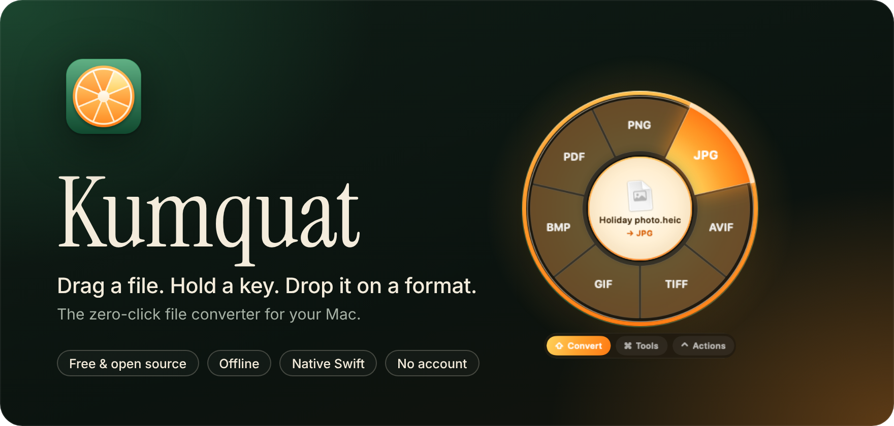
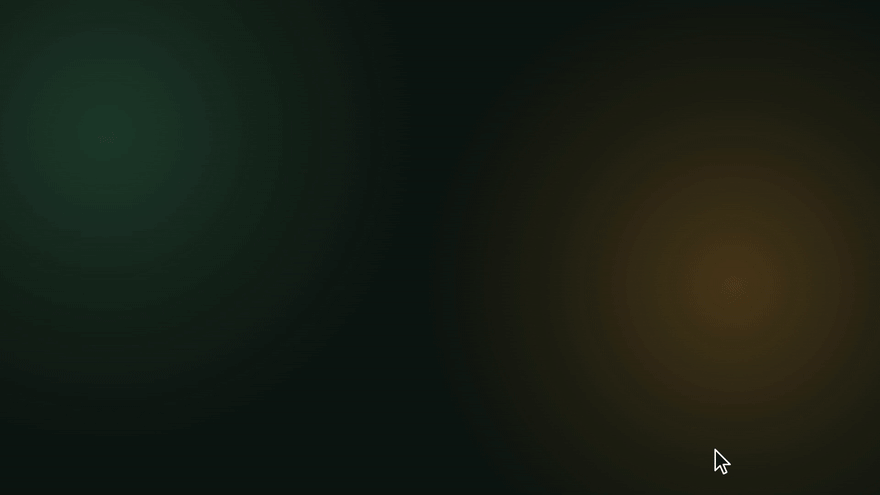
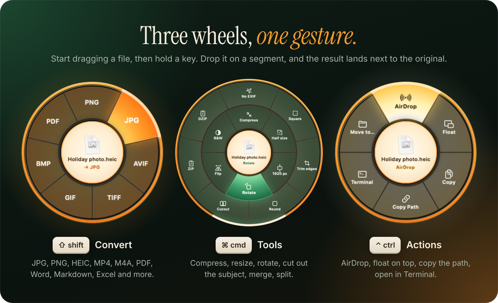
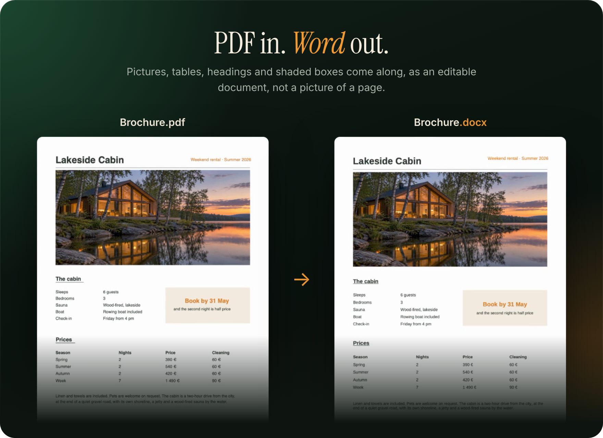
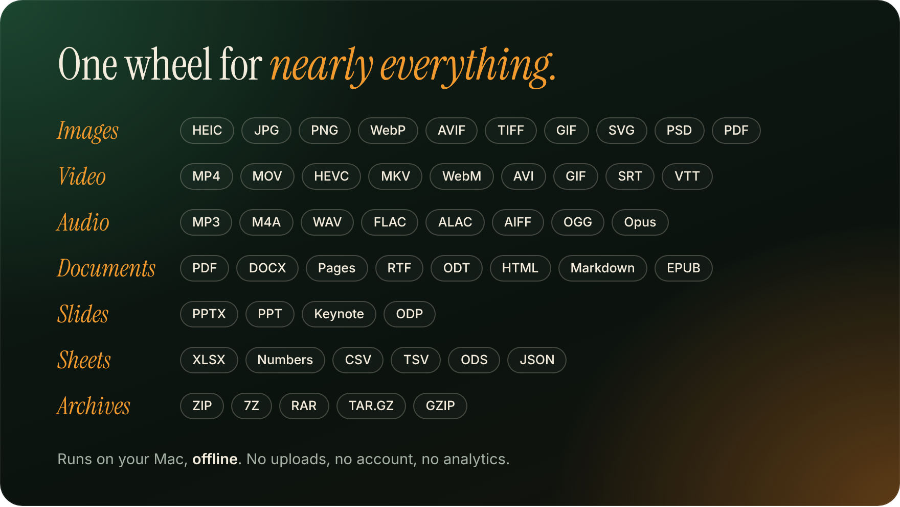

<p align="center">
  
</p>

<p align="center">
  <a href="https://github.com/synthentica/kumquat/releases/latest"></a>
</p>

<p align="center">
  
  
  
  <a href="LICENSE"></a>
</p>

<br>

<p align="center">
  
</p>

<p align="center">
  <a href="https://github.com/synthentica/kumquat/raw/previews/demo.mp4"><b>▶ Watch the 30-second demo</b></a>
</p>

<br>

## How it works

Start dragging any file or folder, from Finder or anywhere else, and hold a key. A wheel opens under your pointer. Drop the file on a segment, and the result appears right next to the original. No windows, no dialogs, no Save As.

<p align="center">
  
</p>

You can let go of the key once the wheel is open, and switch wheels by pressing another one.
Prefer the keyboard? Select files in Finder, press **⌃⌥C**, then use the arrow keys, **Tab** and **Return**.
Every key can be changed in Settings.

## PDFs that keep their looks

<p align="center">
  
</p>

Most converters turn a PDF into a wall of text. Kumquat reads each page's text with its fonts and positions, finds the pictures, rules and shaded boxes in the page itself, and rebuilds the layout: columns and label/value rows become tables, wrapped lines become paragraphs, headings stay headings, pictures come along. It works for Word, HTML, EPUB, RTF and Markdown. Scanned pages are read with the Mac's own text recognition.

## What it converts

<p align="center">
  
</p>

Everything runs on your Mac, offline. Kumquat uses what's built into macOS (ImageIO, AVFoundation with the hardware video encoders, PDFKit, Vision, the Cocoa text system and the system archive tools), its own readers and writers for PDF layout, Office, OpenDocument and EPUB files, and a copy of [FFmpeg](https://ffmpeg.org) built into the app for the audio and video formats macOS can't write.

<details>
<summary><b>Every conversion and tool</b></summary>

| Kind | From | To |
| --- | --- | --- |
| Images | JPG, PNG, HEIC, TIFF, GIF, BMP, WebP, AVIF, SVG, PSD | PNG, JPG, HEIC, TIFF, GIF, BMP, WebP, AVIF\*, PDF |
| Video | MP4, MOV, M4V, MKV, WebM, AVI, WMV, FLV | MP4, MOV, HEVC, GIF, M4A, WebM, MKV, AVI, WMV, MP3 |
| Audio | MP3, M4A, AAC, WAV, AIFF, FLAC, CAF, OGG, Opus, WMA | M4A, MP3, WAV, AIFF, FLAC, ALAC, OGG, Opus, WMA |
| PDF | PDF | DOCX, HTML, EPUB, RTF, Markdown, TXT (layout, pictures and tables kept), PNG, JPG (every page at 300 DPI), PPTX, XLSX, Pages‡ |
| Documents | DOCX, DOC, RTF, RTFD, ODT, HTML, TXT, Markdown, EPUB, text clippings, Pages‡ | PDF, DOCX, Markdown, TXT, RTF, ODT, HTML, EPUB, Pages‡ |
| Slides | PPTX, PPT‡, Keynote‡, ODP‡ | PDF, PNG, JPG (every slide), PPTX‡, Keynote‡, ODP‡ |
| Spreadsheets | XLSX, XLS, CSV, TSV, ODS, Numbers‡ | XLSX, ODS, CSV, TSV, JSON, PDF, Markdown, HTML, Numbers‡ |
| Subtitles | SRT, VTT | SRT, VTT, TXT |
| Archives | ZIP, TAR, TAR.GZ, GZ, RAR, 7Z | Extract; files and folders to ZIP, TAR.GZ, TAR, GZIP |

\* When your version of macOS can encode it.
‡ Apple's own formats and old PowerPoint files go through Keynote, Pages or Numbers (free, and on most Macs already), or [LibreOffice](https://www.libreoffice.org) when it's installed.

#### Tools

| Kind | Tools |
| --- | --- |
| Images | Compress, half size, fit to 1920 px, rotate, flip, black and white, remove EXIF and GPS, square crop, trim edges, round corners, cut out the subject (macOS 14+), combine into one PDF |
| Video | Compress (HEVC), 720p, mute, snapshot, rotate, split into 1-minute parts, 2× speed, merge clips |
| Audio | Compress, mono, normalize, trim silence, split into 1-minute parts, merge |
| PDF | Compress, split pages, rotate, merge |
| Anything | ZIP, GZIP |

</details>

## Install

Kumquat needs macOS 13 Ventura or later and runs natively on Apple silicon and Intel.

Download `Kumquat.zip` from the [latest release](https://github.com/synthentica/kumquat/releases/latest), unzip it and move **Kumquat.app** to Applications.
Releases are signed with a Developer ID and notarized by Apple, so the app opens without a warning.

Kumquat lives in the menu bar. It doesn't need Accessibility access. The first time you use **⌃⌥C**, macOS asks whether Kumquat may read your Finder selection.

## Privacy

Kumquat never uploads anything and has no analytics. Files are read and written only on your Mac.

## Build from source

```sh
git clone https://github.com/synthentica/kumquat.git
cd kumquat
swift run Kumquat         # run from the terminal
swift test                # run the test suite
./scripts/bundle.sh       # build a universal build/Kumquat.app
```

You can also open `Package.swift` in Xcode. `scripts/release.sh` signs, notarizes and staples a release with your own Developer ID.

### Layout

```
Sources/KumquatCore   Format detection, the operation catalog and every converter
Sources/Kumquat       The menu bar app: drag monitor, wheel, toasts, settings
Tests                 End-to-end tests that create real files and convert them
scripts               App bundling, FFmpeg, releases, the corpus run and the icon, drawn in code
```

Adding a format usually means a few lines in `OperationCatalog.swift` and, if needed, a small engine in `Sources/KumquatCore/Engines`.

### How it's tested

Besides the unit tests, `scripts/corpus.sh` downloads a corpus of real-world files that are hard to get right: HDR and Dolby Vision iPhone video, 200-megapixel HEICs with gain maps, CMYK JPEGs, a 501-page book, scanned and rotated PDFs, XFA forms, password-protected files, Keynote, Pages and Numbers documents, damaged archives and names with Finnish and Swedish letters. It converts every one to every offered format and checks each result with outside tools: FFmpeg (SSIM and length), qpdf, veraPDF and LibreOffice. `Kumquat --benchmark` measures how fast the wheel opens and how fast common conversions run against fixed budgets.

## Third-party software

Kumquat.app includes FFmpeg, built by `scripts/build-ffmpeg.sh` under the LGPL 2.1 with LAME (LGPL), Opus, Vorbis, libvpx and libwebp (BSD). The script fetches the exact sources it builds from.

## License

[MIT](LICENSE)
